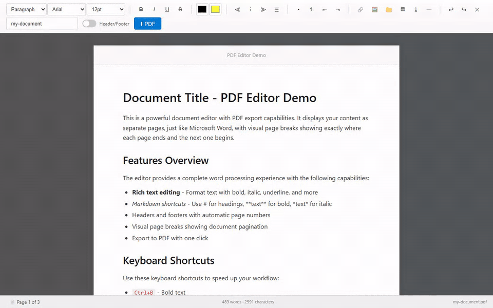
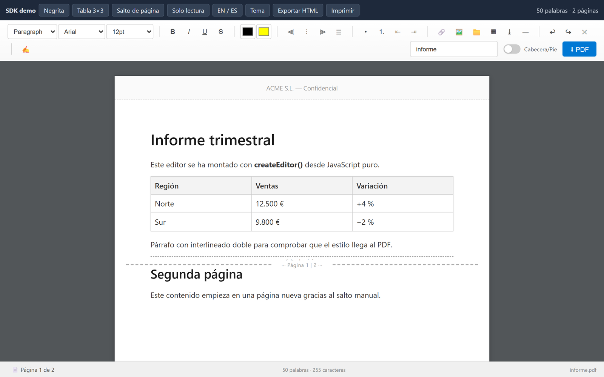
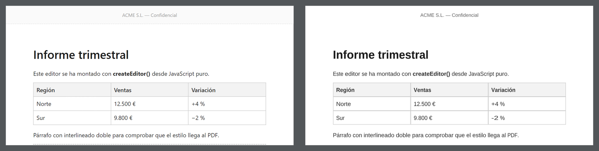

# @jmt-code/pdf-editor

[](https://www.npmjs.com/package/@jmt-code/pdf-editor)
[](https://opensource.org/licenses/MIT)

A Word-like document editor for the web (A4 pages, header and footer, tables, page breaks, Markdown shortcuts) with PDF export that matches what you see. Use it as a React component or, from any framework or plain HTML, as an SDK.

**Live demo:** [React editor](https://jmt-code.github.io/pdfEditor/) · [SDK in plain JavaScript](https://jmt-code.github.io/pdfEditor/sdk.html)



## Features

- 📝 **Rich text**: block formats, font family, size and color, highlight, alignment, lists, indentation, links, images (from a URL or a file), tables, horizontal rules, undo/redo.
- 📄 **Real pages**: A4 pages with header and footer. Page breaks are computed with the same algorithm as the PDF, so the page count always matches. Manual page breaks with Ctrl+Enter.
- 🖨️ **Export**: PDF (`exportPdf`, `downloadPdf`), standalone HTML (`exportHtml`) and printing (`print`).
- 📋 **Clean paste**: content from Word, Google Docs or LibreOffice is cleaned up (Office markup, classes, comments) while bold, italic, lists and colors are kept. Plain text keeps its indentation. Content dragged in from outside is sanitized too.
- ⌨️ **Markdown shortcuts**: `# `, `- `, `1. `, `> `, `**bold** `, `*italic* `...
- 🌍 **i18n**: English and Spanish built in. Any text can be overridden through `messages`.
- 🎨 **Theming**: CSS variables, or the `theme` option in the SDK. Dark mode follows the system.
- 🧩 **SDK**: `createEditor(element, options)` with methods and events, for React, Vue, Angular, Svelte or plain JS. Also a `<script>` bundle with no build step.
- 🔒 **Secure by default**: all HTML goes through DOMPurify, and URLs and CSS values are validated.
- 🔧 **TypeScript**: full types for ESM and CJS.

## Installation

```bash
npm install @jmt-code/pdf-editor
```

## Quick start

### React

```tsx
import { PdfEditor } from '@jmt-code/pdf-editor';
import '@jmt-code/pdf-editor/style.css';

export default function App() {
  return (
    <div style={{ height: '100vh' }}>
      <PdfEditor
        config={{ locale: 'es', defaultHeaderText: 'ACME S.L.', defaultFooterText: 'Página {pageNumber} de {totalPages}' }}
        onChange={(html) => save(html)}
      />
    </div>
  );
}
```

### Any framework / plain JavaScript (SDK)

```ts
import { createEditor } from '@jmt-code/pdf-editor/sdk';
import '@jmt-code/pdf-editor/style.css';

const editor = createEditor(document.getElementById('editor')!, {
  locale: 'es',
  content: { version: 1, html: '<h1>Informe</h1>', header: 'ACME', footer: 'Página {pageNumber}', fileName: 'informe' },
  theme: { primary: '#7c3aed' },
});

await editor.ready;
editor.on('change', ({ document }) => save(document)); // { version, html, header, footer, fileName }
editor.insertTable(3, 3);
const pdf = await editor.exportPdf();
editor.destroy();
```

The container must have a height: the editor fills it.



### `<script>` tag (no build step)

```html
<div id="editor" style="height: 100vh"></div>
<script src="https://unpkg.com/@jmt-code/pdf-editor/dist/pdf-editor.sdk.js"></script>
<script>
  const editor = PdfEditorSDK.createEditor(document.getElementById('editor'), { locale: 'es' });
</script>
```

This bundle includes React, DOMPurify and pdf-creator, and injects its own styles (about 85 KB gzip).

## SDK API

### `createEditor(element, options?)`

| Option | Description |
|---|---|
| `content` | Initial HTML, or an `EditorDocument` (`{ version: 1, html, header, footer, fileName }`). |
| `header`, `footer`, `fileName`, `placeholder` | Initial values. The footer supports `{pageNumber}` and `{totalPages}`. |
| `readOnly` | Read-only mode. Disables editing, the toolbar, the header/footer panel and shortcuts. |
| `locale`, `messages` | Language (`'en'`, `'es'`) and overrides for individual texts. |
| `theme` | `{ primary, primaryHover, background, text, border, toolbarBackground, workspaceBackground, pageBackground, activeBackground, activeColor }`. Only plain colors and linear gradients are accepted. |
| `toolbar` | `false` hides the toolbar. |
| `hiddenTools` | Groups to hide: `blockFormat`, `fontFamily`, `fontSize`, `textStyle`, `colors`, `alignment`, `lists`, `insert`, `history`, `fileName`, `headerFooter`, `export`. |
| `toolbarItems` | Extra buttons: `{ id, label, title?, run(editor) }`. |
| `showHeaderFooterPanel` | Show the header/footer panel from the start. |
| `onExportRequest` | `(pdf, fileName) => void`. Replaces the default download when the export button is clicked. |
| `className`, `style` | Applied to the container. `destroy()` restores the container's original classes and styles. |

### Instance

| Member | Description |
|---|---|
| `ready` | Promise that resolves once the editor is mounted. It rejects if the editor is destroyed before mounting. |
| `getHTML()`, `setHTML(html)` | Content (`setHTML` sanitizes it). |
| `getDocument()`, `setDocument(partial)` | Full document. `setDocument` is atomic and emits a single `change`. |
| `execute(command, value?)` | `bold`, `italic`, `underline`, `strikeThrough`, `undo`, `redo`, `justifyCenter`, `insertUnorderedList`, `foreColor`, `fontSize`, `formatBlock`... Does nothing in read-only mode. |
| `insertTable(rows?, cols?)`, `insertPageBreak()` | Insert elements. |
| `exportPdf()`, `downloadPdf(name?)`, `exportHtml()`, `print()` | Export and print. |
| `getStats()` | `{ words, characters, pages }`. |
| `setReadOnly(bool)`, `configure({ locale, messages, theme, toolbar, hiddenTools, toolbarItems, placeholder })` | Change options without losing the content. Passing `undefined` restores the default. |
| `on(event, fn)` / `off(event, fn)` | Events: `ready`, `change`, `selectionchange`, `stats`, `export`, `error`, `destroy`. `on` returns the function that unsubscribes. |
| `focus()`, `destroy()`, `isDestroyed()` | Lifecycle. Several editors can live on the same page. |

## React component

### Props

| Prop | Type | Description |
|------|------|-------------|
| `config` | `PdfEditorConfig` | See the options below. |
| `onChange` | `(html: string) => void` | The content changed. |
| `onDocumentMetaChange` | `({ header, footer, fileName }) => void` | The header, footer or file name changed. |
| `onSelectionChange` | `(info: { text, collapsed, formats }) => void` | The selection changed (at most once per animation frame). |
| `onStatsChange` | `(stats: { words, characters, pages }) => void` | The statistics changed. |
| `onExport` | `(blob: Blob, fileName: string) => void` | Replaces the default download. |
| `onError` | `(error: Error) => void` | An export failed. |
| `className`, `style` | | Applied to the root element. |

### Config options

| Option | Type | Default | Description |
|--------|------|---------|-------------|
| `initialContent` | `string` | Welcome message | Initial HTML. It is sanitized. |
| `defaultHeaderText` | `string` | `'HEADER'` | Header. |
| `defaultFooterText` | `string` | `'Page {pageNumber}'` | Footer. Supports `{pageNumber}` and `{totalPages}`. |
| `exportFileName` | `string` | `'document'` | PDF file name. |
| `placeholder` | `string` | `'Start typing...'` | Text shown when the editor is empty. |
| `readOnly` | `boolean` | `false` | Read-only mode. |
| `showHeaderFooterPanel` | `boolean` | `false` | Show the header/footer panel. |
| `locale`, `messages` | | `'en'` | Language and text overrides. |
| `hideToolbar`, `hiddenTools`, `toolbarItems` | | | Toolbar customization. |
| `documentWidth`, `documentMinHeight` | `number` | — | **Deprecated and ignored.** The document is always A4. |

### Ref API

```tsx
const ref = useRef<PdfEditorRef>(null);
ref.current?.getContent();
ref.current?.setContent('<p>Hi</p>');
ref.current?.setDocument({ html: '<p>Hi</p>', header: 'New', fileName: 'doc' });
ref.current?.getHeaderFooter();
ref.current?.insertTable(2, 4);
ref.current?.insertPageBreak();
await ref.current?.exportPdf();
await ref.current?.downloadPdf('file');
ref.current?.exportHtml();
await ref.current?.print();
ref.current?.getStats();
ref.current?.execCommand('bold');
```

## Keyboard shortcuts

| Shortcut | Action |
|----------|--------|
| `Ctrl+B` / `Ctrl+I` / `Ctrl+U` | Bold / italic / underline |
| `Ctrl+Enter` | Page break |
| `Ctrl+S` | Export to PDF |
| `Ctrl+Z` / `Ctrl+Y` | Undo / redo |

## Markdown Shortcuts

Type these at the beginning of a line:

| Shortcut | Result |
|----------|--------|
| `# ` | Heading 1 |
| `## ` | Heading 2 |
| `### ` | Heading 3 |
| `- ` or `* ` | Bullet list |
| `1. ` | Numbered list |
| `> ` | Blockquote |
| ```` ``` ```` | Code block |
| `---` | Horizontal rule |

Inline formatting is applied when you type a space after the closing marker:

| Shortcut | Result |
|----------|--------|
| `**text** ` | **Bold** |
| `*text* ` | *Italic* |
| `~~text~~ ` | ~~Strikethrough~~ |
| `` `text` `` + space | `Inline code` |

The typed text is always inserted as text, never as HTML.

## PDF Export



<sub>Left: the editor. Right: the exported PDF. Same layout, same page breaks.</sub>

The PDF uses the same layout as the editor. The browser lays out the content with the editor's styles, and the exporter measures where every word, image, background, border, bullet or number, underline and link ends up, then draws it at that spot in the PDF. As a result:

- Pages break between lines, never through one. The page count in the status bar matches the PDF.
- Supported: headings, paragraphs, bold, italic, underline, strikethrough, colors, highlight, line spacing, indentation, numbered and bullet lists, blockquotes, inline code and code blocks (spaces and line breaks kept), tables with borders and backgrounds, images (scaled down if taller than a page), clickable links, horizontal rules and manual page breaks.
- Text uses the standard PDF fonts (Helvetica, Times or Courier, picked from the CSS font family). Each word is stretched to the width it has on screen. Characters outside WinAnsi (CJK, emoji) become `?`.
- Images from other domains need CORS. If an image can't be loaded, it is skipped and a warning is logged to the console, and the export still finishes.

## Security

- All HTML that enters the editor (`initialContent`, `setContent`/`setDocument`, paste, content dragged in from outside, the content measured for export) goes through `sanitizeHtml` (DOMPurify). It removes scripts, event handlers, iframes, forms and dangerous styles. Only a whitelist of CSS properties is kept, with their values validated.
- SDK theme values only accept colors and linear gradients (no `url()`, `image-set()`, `var()` or escapes).
- Links and images go through `isSafeUrl`. Links accept `http(s)`, `mailto:`, `tel:` and relative URLs. Images accept `http(s)`, relative URLs and `data:image/(png|jpeg|gif|webp)`. `javascript:`, `vbscript:` and other `data:` URLs are blocked.
- Image files inserted from disk must be PNG, JPEG, GIF or WebP, up to 5 MB.

`sanitizeHtml`, `sanitizePastedHtml` and `isSafeUrl` are exported in case you need them in your app.

## Theming

Customize via CSS variables:

```css
.pdf-editor {
  --pdf-editor-bg: #f3f3f3;
  --pdf-editor-text: #333;
  --pdf-editor-toolbar-bg: linear-gradient(180deg, #fff 0%, #f8f8f8 100%);
  --pdf-editor-border: #d4d4d4;
  --pdf-editor-primary: #0078d4;
  --pdf-editor-primary-hover: #106ebe;
  --pdf-editor-workspace-bg: #525659;
  --pdf-editor-page-bg: #ffffff;
  --pdf-editor-header-footer-bg: #fafafa;
  --pdf-editor-active-bg: #cce4ff;
  --pdf-editor-active-color: #0066cc;
}
```

## Recipes

### Save and restore a document (autosave)

`getDocument()` returns plain JSON (`{ version: 1, html, header, footer, fileName }`), so you can store it anywhere.

```ts
import { createEditor, type EditorDocument } from '@jmt-code/pdf-editor/sdk';
import '@jmt-code/pdf-editor/style.css';

const saved = localStorage.getItem('doc');
const editor = createEditor(document.getElementById('editor')!, {
  locale: 'es',
  content: saved ? (JSON.parse(saved) as EditorDocument) : '<h1>Nuevo documento</h1>',
});

let timer: number | undefined;
editor.on('change', ({ document }) => {
  clearTimeout(timer);
  timer = window.setTimeout(() => localStorage.setItem('doc', JSON.stringify(document)), 500);
});
```

### Send the PDF to your server instead of downloading it

```ts
const editor = createEditor(el, {
  // Called by the toolbar's export button (and Ctrl+S)
  onExportRequest: async (pdf, fileName) => {
    const body = new FormData();
    body.append('file', pdf, `${fileName}.pdf`);
    await fetch('/api/documents', { method: 'POST', body });
  },
});

// Or from your own code
const pdf = await editor.exportPdf(); // Blob
```

### Custom toolbar buttons and a trimmed toolbar

```ts
const editor = createEditor(el, {
  hiddenTools: ['fontFamily', 'colors', 'headerFooter'],
  toolbarItems: [
    { id: 'signature', label: '✍', title: 'Insert signature', run: (ed) => ed.setHTML(ed.getHTML() + '<p><em>Firmado: ACME S.L.</em></p>') },
    { id: 'save', label: 'Save', run: (ed) => api.save(ed.getDocument()) },
  ],
});
```

### Read-only viewer, theme and language at runtime

```ts
const viewer = createEditor(el, { content: doc, readOnly: true, toolbar: false });

editor.setReadOnly(true);
editor.configure({ locale: 'en', theme: { primary: '#7c3aed', toolbarBackground: '#faf5ff' } });
editor.configure({ theme: undefined }); // back to the default theme
```

### Listen to the editor

```ts
const off = editor.on('stats', ({ words, pages }) => (status.textContent = `${words} words · ${pages} pages`));
editor.on('selectionchange', ({ formats }) => boldButton.classList.toggle('active', formats.includes('bold')));
editor.on('error', (err) => console.error('Export failed', err));
off(); // unsubscribe
```

### Vue 3

```vue
<script setup lang="ts">
import { onMounted, onBeforeUnmount, ref } from 'vue';
import { createEditor, type EditorInstance } from '@jmt-code/pdf-editor/sdk';
import '@jmt-code/pdf-editor/style.css';

const host = ref<HTMLElement>();
const emit = defineEmits<{ change: [html: string] }>();
let editor: EditorInstance | undefined;

onMounted(() => {
  editor = createEditor(host.value!, { locale: 'es' });
  editor.on('change', ({ html }) => emit('change', html));
});
onBeforeUnmount(() => editor?.destroy());
</script>

<template><div ref="host" style="height: 80vh" /></template>
```

### Angular

```ts
import { AfterViewInit, Component, ElementRef, OnDestroy, ViewChild } from '@angular/core';
import { createEditor, type EditorInstance } from '@jmt-code/pdf-editor/sdk';
// Add "node_modules/@jmt-code/pdf-editor/dist/style.css" to "styles" in angular.json

@Component({ selector: 'app-editor', standalone: true, template: '<div #host style="height: 80vh"></div>' })
export class EditorComponent implements AfterViewInit, OnDestroy {
  @ViewChild('host') host!: ElementRef<HTMLElement>;
  private editor?: EditorInstance;

  ngAfterViewInit() {
    this.editor = createEditor(this.host.nativeElement, { locale: 'es' });
  }
  ngOnDestroy() {
    this.editor?.destroy();
  }
}
```

### Svelte

```svelte
<script lang="ts">
  import { onMount } from 'svelte';
  import { createEditor } from '@jmt-code/pdf-editor/sdk';
  import '@jmt-code/pdf-editor/style.css';

  let host: HTMLElement;
  onMount(() => {
    const editor = createEditor(host, { locale: 'es' });
    return () => editor.destroy();
  });
</script>

<div bind:this={host} style="height: 80vh"></div>
```

### React: control the editor through a ref

```tsx
import { useRef } from 'react';
import { PdfEditor, type PdfEditorRef } from '@jmt-code/pdf-editor';
import '@jmt-code/pdf-editor/style.css';

export function ReportEditor({ initial, onSave }: { initial: string; onSave: (html: string) => void }) {
  const ref = useRef<PdfEditorRef>(null);
  return (
    <>
      <button onClick={() => onSave(ref.current!.getContent())}>Save</button>
      <button onClick={() => ref.current?.downloadPdf('report')}>PDF</button>
      <div style={{ height: '80vh' }}>
        <PdfEditor ref={ref} config={{ initialContent: initial, locale: 'es', hiddenTools: ['fontFamily'] }} />
      </div>
    </>
  );
}
```

### Generate a PDF from HTML without showing the editor

Runs in the browser (the layout is measured with the DOM). The HTML is sanitized first.

```ts
import { generatePdfFromContent, downloadPdf } from '@jmt-code/pdf-editor';

const html = '<h1>Factura 2026-001</h1><p>Total: <strong>120 €</strong></p>';
const blob = await generatePdfFromContent(html, 'ACME S.L.', 'Página {pageNumber} de {totalPages}');
downloadPdf(blob, 'factura.pdf');
```

### Building your own UI

`Toolbar`, `HeaderFooterPanel`, `PageIndicator` and the hooks (`useEditorCommands`, `useMarkdownShortcuts`, `usePaste`, `usePageCalculation`) are exported for advanced cases, but their props may change between minor versions. For most needs, prefer `hideToolbar` / `toolbar: false` plus your own buttons calling the ref or SDK methods (`execute('bold')`, `insertTable()`...).

## Requirements

- React 18 or 19 (`react` and `react-dom`), except for the `<script>` bundle, which includes React
- A browser environment (PDF export measures the layout with the DOM)

## Browser Support

- Chrome/Edge (latest)
- Firefox (latest)
- Safari (latest)

## License

MIT

---

Created by [Jmt-code](https://github.com/Jmt-code)
